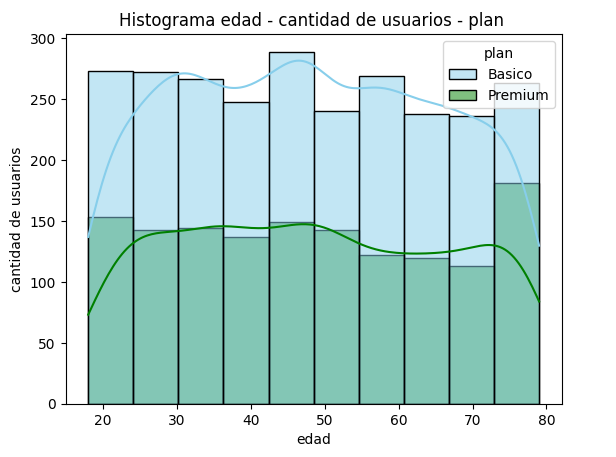

# Santiago Cortés

Welcome! I am a **Data Analyst** dedicated to turning complex data into clear, actionable business strategies.

[View My GitHub Profile](https://github.com)

# About Me

A results-driven Engineering professional specializing in Data Analysis, with a solid background in extracting, cleaning, transforming, and modeling data to support strategic decision-making. 

My focus centers on translating raw data into impactful insights and automating processes to optimize operational efficiency and drive business growth.

### Technical Skills
- **Data Analysis & Management:** Excel / SQL / Python
- **Data Visualization & BI:** Tableau / Power BI
- **Python Libraries:** Pandas / NumPy / Matplotlib / Seaborn

---

# Selected Projects

## Customer Behavior Analysis for ConnectaTel

In the telecommunications sector, understanding consumption patterns is essential to **ensure customer retention** and **optimize commercial plans**. This project analyzes the behavior of ConnectaTel users in Latin America to identify data anomalies, detect usage patterns (calls, messages, and internet), and generate actionable loyalty strategies.

#### Tools & Project Type
Python / Pandas / Matplotlib / Seaborn / Data Cleaning / Exploratory Data Analysis (EDA) / Customer Segmentation

### Key Questions
1. Which customer segments consume the highest amount of network resources?
2. Are there anomalies, outliers, or severe quality issues in the collected data?
3. What behavioral patterns can help us design better plans to prevent customer churn?

### Methodology
- **Quality Assessment & Cleaning:** Identified and handled missing values, invalid records, and statistically detected outliers across the user, plan, and usage datasets.
- **Exploratory Data Analysis (EDA):** Evaluated behavioral trends by cross-referencing minutes consumed, messages sent, and customer demographics.
- **Segmentation:** Grouped customers based on consumption characteristics to understand the value and footprint of each profile.

### Insights & Recommendations
- **Data Quality Priority:** Discovered invalid records that skewed core metrics; fixing these data pipelines at the source will prevent biased commercial reporting.
- **Usage-Based Retention:** Call and data usage patterns highlighted segments underutilizing their plans, presenting an opportunity to offer proactive, controlled downgrades before they churn.
- **Plan Optimization:** Generated data-driven recommendations to restructure current commercial plan offerings based on actual user demand.

### Key Visualizations

1. **Message Volume Distribution by Plan:** This histogram shows the distribution of messages sent across different subscription tiers. Both "Basico" and "Premium" user groups display a heavily clustered behavior around 3 to 7 messages, showing that communication volume does not change significantly based on the selected tier.

2. **Age Distribution Across Subscription Tiers:** This visualization evaluates age metrics against user volume per plan. The uniform distribution across all brackets indicates that age is not a driving factor in plan selection, meaning marketing efforts can focus on usage habits rather than age-specific targeting.

**[Explore the full repository and Jupyter Notebook code here](https://github.com)**

